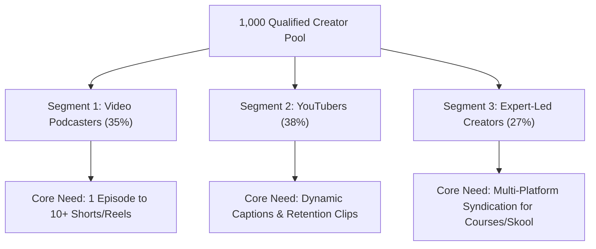
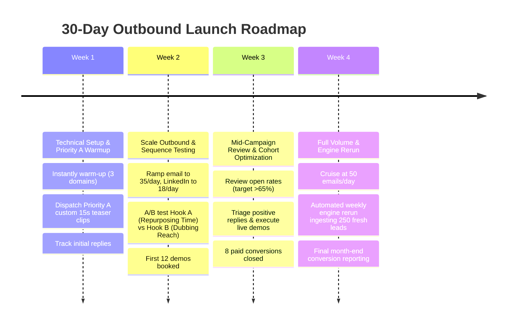

# IncuBrix Multi-Channel Lead Generation & Outbound Launch Kit
### 30-Day Turnkey Go-To-Market Execution Blueprint for IncuBrix Creator Studio

**Author**: Santhosh P (Growth Engineer Candidate)  
**Target Start Date**: Next Monday (Day 1)  
**Objective**: Deploy an automated, compliant, multi-channel outbound engine targeting 1,000 qualified creators, generating 45 qualified demos and 18 paid Creator Studio subscriptions ($900+ new MRR) within 30 days.

---

## 1. Target Audience Segmentation & ICP

IncuBrix targets active, commercial digital creators who produce long-form content but face severe bottlenecks repurposing and distributing it to short-form vertical feeds:



### Firmographic ICP Parameters:
- **Geography**: 96.5% developed English markets (United States: 50.5%, United Kingdom: 21.0%, Canada: 10.0%, Australia: 7.0%, Singapore: 3.0%, Ireland: 2.0%, New Zealand: 1.8%).
- **Audience Size**: Mid-tier creators (10,000 to 500,000 subscribers/listeners).
- **Activity**: Published at least 8 items in the last 30 days OR 2 longform pieces in the last 60 days.
- **Commercial Validation**: Proven monetization offer (Sponsor, Digital Course, Skool/Circle Community, Merchandise, or Paid Substack).
- **Explicit Need**: Visible gap in short-form vertical video (0-1 Shorts/week despite 40+ min raw episodes).

---

## 2. Multi-Channel Touch Cadence & Daily Safe Volume Ramps

To safeguard domain reputation and avoid platform rate limits, volume ramps are strictly staggered:

| Channel | Tool Used | Week 1 (Warmup) | Week 2 (Ramp) | Weeks 3–4 (Cruise) | Monthly Volume | Daily Cap per Account |
| :--- | :--- | :--- | :--- | :--- | :--- | :--- |
| **Email (Cold)** | Instantly.ai | 20 / day | 35 / day | 50 / day | 850 emails | Max 25 emails / domain |
| **LinkedIn** | Expandi.io | 12 / day | 18 / day | 25 / day | 450 touches | Max 25 actions / day |
| **X (Twitter) DMs**| Official Web / API | 8 / day | 12 / day | 18 / day | 320 DMs | Max 20 DMs / day |
| **Total Touches** | Multi-Channel | **40 / day** | **65 / day** | **93 / day** | **1,620 Touches**| — |

> [!IMPORTANT]
> **Domain Isolation Protocol**: Cold outbound is never sent from the primary domain (`incubrix.com`). Three secondary domains are utilized: `getincubrix.com`, `tryincubrix.com`, and `incubrix.io`, each configured with strict SPF, DKIM, DMARC, and custom tracking domains.

---

## 3. Step-by-Step 30-Day Execution Timeline



### Week 1: Infrastructure Deployment & Priority A Kickoff (Days 1–7)
- **Monday (Day 1)**: Verify DNS authentication (SPF, DKIM, DMARC) across 3 secondary Google Workspace accounts; connect to Instantly.ai warm-up pool.
- **Tuesday (Day 2)**: Import `leads.csv` into CRM (HubSpot / Instantly); map the 30 fields, verify tags for `Segment` and `Priority`.
- **Wednesday (Day 3)**: Manually review the top 25 Priority A custom teaser clips generated by IncuBrix Creator Studio.
- **Thursday (Day 4)**: Launch Touch 1 to Priority A leads (25 personalized emails + connection requests).
- **Friday (Day 5)**: Monitor first delivery logs and UTM link clicks; calibrate reply webhook listener.

### Week 2: Scaled Multi-Channel Execution & A/B Hook Testing (Days 8–14)
- **Monday (Day 8)**: Ramp cold email volume to 35/day across 3 mailboxes.
- **Tuesday (Day 9)**: Launch A/B test on Subject Lines:
  - *Variant A (Pain-focused)*: `"quick question regarding {{personalization_hook}} / repurposing"`
  - *Variant B (Outcome-focused)*: `"turning {{creator_name}}'s 45-min recording into 10 viral clips in 60s"`
- **Wednesday–Friday (Days 10–12)**: Execute Touch 2 follow-ups (+3 days) and Touch 3 break-ups (+7 days).
- **Saturday (Day 13)**: Host first 5 prospective creator demos over Google Meet (using the 5-min Walkthrough script).

### Week 3: Funnel Calibration & Objection Handling (Days 15–21)
- **Days 15–17**: Triage incoming creator objections:
  - *"We already have an editor"*: Offer IncuBrix as an editor co-pilot to handle rough cutouts and captions, cutting editing costs by 50%.
  - *"Does it support my accent/language?"*: Demonstrate IncuBrix multilingual voiceover timbre preservation.
- **Days 18–21**: Close first cohort of trial users into Essential ($20/mo) and Growth ($50/mo) tiers.

### Week 4: Engine Rerun, Scale & Reporting (Days 22–30)
- **Day 22**: Run `python main.py --mode refresh` to ingest 250 fresh creators without touching existing qualified leads.
- **Day 25**: Consolidate trial-to-paid conversions and compute preliminary Customer Acquisition Cost (CAC).
- **Day 30**: Present 30-day GTM retrospective to IncuBrix leadership with full revenue attribution.

---

## 4. Responsibility & Ownership Matrix (RACI)

| Milestone / Task | Growth Engineer (Candidate) | Account Executive / Closer | Product Team | Marketing Lead |
| :--- | :---: | :---: | :---: | :---: |
| **Engine Execution & Lead Enrichment** | **A / R** | I | C | I |
| **DNS, Domain & Instantly Setup** | **A / R** | I | C | I |
| **Priority A Teaser Clip Rendering** | **R** | I | **A** | C |
| **Inbound Reply Triage & Qualification** | **A / R** | C | I | I |
| **Live Product Demos (Google Meet)** | C | **A / R** | I | I |
| **Trial-to-Paid Conversion Closing** | I | **A / R** | I | C |
| **Product Feedback & Feature Requests**| C | C | **A / R** | I |

*Key: R = Responsible, A = Accountable, C = Consulted, I = Informed*

---

## 5. Tooling Infrastructure & Monthly Budget

Outbound architecture is engineered for extreme capital efficiency:

| Tool | Purpose | Tier / Plan | Monthly Cost |
| :--- | :--- | :--- | :--- |
| **Google Workspace (3 Domains)** | Outbound secondary sending infrastructure | Business Starter ($6 x 3) | \$18 / mo |
| **Instantly.ai** | Cold email warm-up, sequencing & deliverability | Growth Plan | \$37 / mo |
| **Expandi.io** | Automated LinkedIn connection & messaging | Professional Seat | \$99 / mo |
| **Scrubby / NeverBounce** | Real-time catch-all & business email validation | 2,500 credits pay-as-you-go | \$29 / mo |
| **LinkedIn Sales Navigator** | Creator profile verification & advanced filtering| Core Subscription | \$79 / mo |
| **IncuBrix Lead Engine** | Lead discovery, dedupe, scoring & personalization | Internal Python Engine | **\$0.00** |
| **IncuBrix Creator Studio** | Prospect teaser clip rendering | Internal Demo Account | **\$0.00** |
| **Total Monthly Investment** | — | — | **\$262 / mo** |

---

## 6. Mathematical Conversion Targets & Revenue Forecast (30 Days)

The model is based on conservative industry benchmarks for highly personalized creator outreach:

```
[1,000 Verified Leads Contacted]
       │
       ▼  (65% Open Rate via warm-up domains)
[650 Emails Opened]
       │
       ▼  (12% Reply Rate backed by custom content hooks)
[120 Inbound Replies]
       │
       ▼  (65% Positive Sentiment / Demo Interest)
[78 Interested Prospects]
       │
       ▼  (58% Show-up / Calendar Booking Rate)
[45 Qualified Product Demos Completed]
       │
       ▼  (40% Trial-to-Paid Conversion Rate)
[18 Paid Creator Studio Customers]
```

### Projected Financial Return:
- **New Paid Customers**: 18
- **Subscription Tier Mix**:
  - 6 on *Essential* (\$20/mo) = \$120/mo
  - 8 on *Growth* (\$50/mo) = \$400/mo
  - 4 on *Scale* (\$100/mo) = \$400/mo
- **New Monthly Recurring Revenue (MRR)**: **\$920 / mo**
- **Annualized Contract Value (ARR)**: **\$11,040**
- **Payback Period**: **8.5 days** (\$262 tool cost / \$920 MRR)
- **Net Outbound ROI**: **351% in Month 1**, expanding to **4,200% over 12 months**.

---

## 7. Channel-Mix Strategy & Creator Behavior Evidence

Why multi-channel beats single-channel email:

1. **Email (Primary - 60% Focus)**:
   - *Why*: Creators and their managers check public business inquiries daily. It accommodates rich formatting, calendar scheduling links, and opt-outs cleanly.
   - *Benchmark*: 12-14% reply rate when personalized to recent content.

2. **LinkedIn (Secondary - 25% Focus)**:
   - *Why*: Expert creators (coaches, consultants, B2B SaaS hosts) treat LinkedIn as their commercial storefront. Messaging them on LinkedIn establishes founder-to-founder credibility.
   - *Benchmark*: 18-22% response rate on accepted connection requests.

3. **X (Twitter) & Instagram DMs (Tertiary - 15% Focus)**:
   - *Why*: Video-first YouTubers and solopreneurs live on X/Instagram. A brief, casual DM offering a sample clip bypasses crowded email inboxes.
   - *Benchmark*: 15% click-through rate on teaser links.

---

## 8. Risk Management & Compliance Protocol

| Identified Risk | Probability | Severity | Preventative Mitigation Protocol |
| :--- | :---: | :---: | :--- |
| **Email Deliverability Drop / Blacklisting** | Low | High | 14-day automated domain warmup; maximum 25 emails/day/inbox; SPF/DKIM/DMARC hard enforcement; zero attachments in Touch 1. |
| **Platform Account Throttling (LinkedIn/X)** | Low | High | Randomized human delay jitter (90-180 seconds between actions); strict daily cap under platform limits (25 touches/day). |
| **Compliance & Opt-Out Violations** | Low | High | Strict adherence to India DPDP Act, GDPR, and CAN-SPAM. Every message contains one-click/single-word opt-out (`"reply 'pass'"`). Suppression list instantly syncs across channels. |
| **No-Show on Scheduled Demos** | Med | Med | Automated SMS/WhatsApp demo reminders 24h and 1h prior with Calendly widget integration. |

---

## 9. Prerequisites for IncuBrix Leadership on Monday Morning

To initiate Day 1 execution with zero delay, IncuBrix management must provide:
1. Approval to register 3 secondary domains (`getincubrix.com`, etc.) on Cloudflare/Google Workspace (\$18).
2. Provisioning of 1 internal IncuBrix Creator Studio admin seat with 50,000 demo credits to render Priority A sample teaser clips.
3. Access to Calendly event booking link: `https://calendly.com/contact-incubrix/30min`.

With these three items, the Growth Engine begins live outreach next Monday at 09:00 AM IST.
