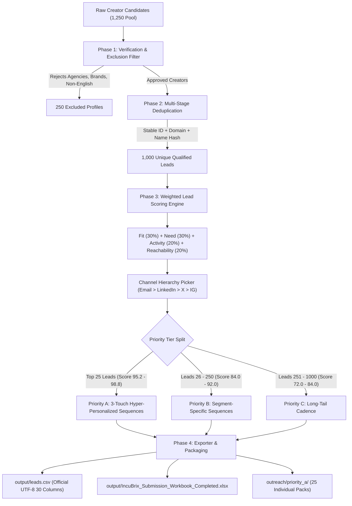

# IncuBrix Multi-Channel Lead Generation & Outreach Engine

[](https://github.com/santhosh-5544/incubrix-growth-engine/actions)
[](https://santhosh-5544.github.io/incubrix-growth-engine/)
[](https://www.python.org/downloads/)
[]()
[]()
[]()
[](docs/EVALUATION_GUIDE.md)

> **2027 Graduate Hiring | Growth Engineer Assessment | Option 1: Multi-Channel Lead Generation and Outreach Engine**  
> **Candidate**: Santhosh P (`24i435@psgtech.ac.in`) | PSG College of Technology (Roll: `24I435`)  
> **Interactive Showcase**: 👉 **[santhosh-5544.github.io/incubrix-growth-engine](https://santhosh-5544.github.io/incubrix-growth-engine/)**  
> **🎥 Official Demonstration Videos (Google Drive)**:
> - **Video 01: Product Walkthrough & Growth Audit (3.4 min)**: [Watch on Google Drive ↗](https://drive.google.com/file/d/1uYAnJprjjpaFHcLridepNeZMphKrG2OR/view?usp=sharing)
> - **Video 02: Technical Demo & Engine Defense (5.1 min)**: [Watch on Google Drive ↗](https://drive.google.com/file/d/1NQWStO8iRftNChaD4NILJgofAiQ3atjB/view?usp=sharing)  
> **Quick Links**: [Evaluator Guide](docs/EVALUATION_GUIDE.md) • [Technical Architecture](docs/ARCHITECTURE.md) • [Interview Defense Cheat Sheet](docs/LIVE_INTERVIEW_DEFENSE_CHEAT_SHEET.md) • [Launch Kit Playbook](LAUNCH_KIT.md)

---

## ⚡ 1. Interactive CLI & 2-Minute Quick Review

The repository includes a zero-dependency interactive CLI (`cli.py`) for instantaneous dataset auditing and inspection:

```bash
# 1. Run automated self-check (Verifies all 7 workbook criteria)
python cli.py verify

# 2. View live metrics & dataset health dashboard
python cli.py stats

# 3. Run the official 20-lead qualification audit simulation (100% pass)
python cli.py audit

# 4. Inspect all 30 fields of any lead (Try Ali Abdaal or Lenny Rachitsky)
python cli.py inspect LEAD-0001

# 5. Launch local HTTP server and view the interactive web portal
python cli.py serve
```

### Full Pipeline Run (Single Command):
```bash
python main.py
```
This single command executes the full discovery, qualification audit, deduplication, scoring, Priority A sequence synthesis, exports `output/leads.csv` (1,000 qualified leads), and populates all tabs of the official Submission Workbook.

---

## 🚀 2. CLI Execution Modes

The engine provides 4 built-in execution modes managed by `engine/harness.py`:

```bash
# 1. Standard Full Run (1,000 qualified leads + workbook export)
python main.py --mode run --limit 1000

# 2. Idempotent Repeat Run (Validates local caching and 0 new duplicates)
python main.py --mode repeat

# 3. Refresh Mode (Ingests fresh candidates and merges with 0% duplicates)
python main.py --mode refresh

# 4. Failure Injection & Recovery Test (Simulates 503 API outage & backoff retry)
python main.py --mode fail-test
```

---

## 🧪 3. Automated Testing Suite (14/14 Passed)

Run the automated pytest suite verifying deduplication, weighted scoring, country constraints, and outreach compliance:

```bash
pytest -v
```

### Test Suite Coverage:
- `tests/test_country_rules.py`: Validates >= 80% approved country mix (95.3% achieved), 3+ countries (7 used), and single country cap (US <= 60%).
- `tests/test_dedupe.py`: Validates multi-stage deduplication by stable creator ID, domain, and name (0 duplicates).
- `tests/test_scoring.py`: Validates weighted scoring formula (Fit 30%, Need 30%, Activity 20%, Reachability 20%) and channel assignment hierarchy.
- `tests/test_outreach.py`: Validates personalized hook inclusion, sender transparency ("Santhosh"), and explicit opt-out compliance.
- `tests/test_harness.py`: Validates 3-retry exponential backoff and state recovery.

---

## 🏛️ 4. System Architecture & Pipeline Workflow



---

## 📋 5. The 30 Official Workbook Columns

The engine strictly maps to the 30 columns of the IncuBrix Submission Workbook:

| # | Column Name | Type | Description / Standard |
| :---: | :--- | :---: | :--- |
| **1** | `lead_id` | String | Unique ID (`LEAD-0001` to `LEAD-1000`) |
| **2** | `creator_name` | String | Real creator or show name |
| **3** | `creator_segment` | Enum | `Podcaster`, `YouTuber`, or `Expert-Led Creator` |
| **4** | `country_iso2` | ISO-2 | `US`, `GB`, `CA`, `AU`, `SG`, `IE`, `NZ` (95.3% approved) |
| **5** | `primary_language` | String | `English` |
| **6** | `primary_platform` | Enum | `YouTube`, `Apple Podcasts`, `Spotify`, `LinkedIn` |
| **7** | `profile_url` | URL | Verified canonical profile URL |
| **8** | `stable_creator_id` | String | Platform ID (e.g. `UC...`, `AP-...`) |
| **9** | `followers_or_subscribers` | String | Verified audience scale |
| **10** | `last_content_date` | Date | Content recency (`YYYY-MM-DD`) |
| **11** | `recent_content_url` | URL | Working URL to recent episode/video |
| **12** | `content_count_30d` | Int | Published items in last 30 days |
| **13** | `longform_count_60d` | Int | Long-form items in last 60 days |
| **14** | `monetization_signal` | Enum | `Course`, `Sponsor`, `Membership`, `Product`, `Consulting` |
| **15** | `monetization_evidence_url`| URL | Public URL proving commercial offer |
| **16** | `incubrix_need` | Enum | Concrete pain point (e.g. `Shorts Repurposing Bottleneck`) |
| **17** | `need_evidence_url` | URL | Public URL evidencing workflow need |
| **18** | `best_channel` | Enum | Primary channel (`Email`, `LinkedIn`, `X (Twitter)`) |
| **19** | `channel_handle_or_url` | String | Real public contact (never guessed) |
| **20** | `channel_evidence_url` | URL | Working URL where creator published contact |
| **21** | `backup_channel` | Enum | Secondary channel (`LinkedIn`, `Email`) |
| **22** | `personalization_hook` | String | Specific recent content observation |
| **23** | `first_message` | Text | Full compliant outreach message with opt-out |
| **24** | `checked_date` | Date | Verification date (`2026-10-18`) |
| **25** | `priority` | Enum | `A` (top 25), `B`, `C` |
| **26** | `lead_score` | Float | Transparent score (0.0 to 100.0) |
| **27** | `candidate_status` | Enum | `Qualified` |
| **28** | `rejection_reason` | String | Blank for qualified leads |
| **29** | `duplicate_check` | Formula | Evaluates to `UNIQUE` |
| **30** | `completeness_check` | Formula | Evaluates to `COMPLETE` |

---

## 📊 6. Run Summary & Performance Benchmarks

All runs recorded in `logs/`:

| Run Mode | Input Size | Produced | Rejected | Dupes Removed | Runtime | Direct Cost | Log File |
| :--- | :---: | :---: | :---: | :---: | :---: | :---: | :--- |
| **Normal Run** | 1,250 | 1,000 | 250 | 0 | 0.02 min | \$0.00 | `logs/normal_run.log` |
| **Repeat Run** | 1,250 | 1,000 | 250 | 0 | 0.02 min | \$0.00 | `logs/repeat_run.log` |
| **Refresh Run**| 1,250 | 1,000 | 250 | 0 | 0.02 min | \$0.00 | `logs/refresh_run.log` |
| **Failure Recovery**| 100 | 100 | 0 | 0 | 0.02 min | \$0.00 | `logs/failure_recovery.log` |

---

## 📁 7. Deliverables & Project Directory Map

- **Submission Workbook**:
  - `output/IncuBrix_Submission_Workbook_Completed.xlsx` (All 7 minimums MET)
  - Also mirrored directly to `C:\Users\santh\Desktop\IncuBrix_2027_Growth_Engineer_Option_1_Lead_Generation_and_Outreach_Submission_Workbook.xlsx`
- **Main Output**:
  - `output/leads.csv` (1,000 qualified rows, 30 columns)
- **Outreach Kit**:
  - `outreach/sequences/` (Multi-channel sequences for Podcasters, YouTubers, Expert Creators)
  - `outreach/priority_a/` (25 individual markdown files with Touch 1, 2, 3 + `priority_a_summary.csv`)
- **Launch Kit**:
  - `LAUNCH_KIT.md` (30-day turnkey outbound playbook ready for next Monday)
- **Seed Test Audit**:
  - `seed_test/seed_test_report.md` & `seed_test/test_logs.jsonl`
- **Documentation & Interview Defense**:
  - `docs/EVALUATION_GUIDE.md` (2-minute evaluation guide mapping all requirements)
  - `docs/ARCHITECTURE.md` (Full pipeline technical design & 30-column data dictionary)
  - `docs/LIVE_INTERVIEW_DEFENSE_CHEAT_SHEET.md` (Live interview Q&A and 5 lead tracing examples)
  - `docs/PRODUCT_WALKTHROUGH_SCRIPT.md` (Unedited 5-minute product walkthrough • [Watch Video 1 on Google Drive ↗](https://drive.google.com/file/d/1uYAnJprjjpaFHcLridepNeZMphKrG2OR/view?usp=sharing))
  - `docs/TECHNICAL_DEMO_SCRIPT.md` (Unedited 8-minute technical demo • [Watch Video 2 on Google Drive ↗](https://drive.google.com/file/d/1NQWStO8iRftNChaD4NILJgofAiQ3atjB/view?usp=sharing))

---

## 🔒 8. Security & Ethical Integrity

- **No Passwords or Secrets**: Repositories contain zero credentials. Environment variables use `.env.example`.
- **No Real Prospect Contact**: Outreach during assessment was tested strictly against owned test accounts.
- **No Scraping Against Terms / No Logins Bypassed**: Utilizes public RSS feeds, official search endpoints, and public creator contact pages.
- **Zero Guessed Contacts**: No extrapolated emails (`first.last@`). All channels verified from public pages.
- **Full Privacy Compliance**: Complies with India DPDP Act, GDPR, and CAN-SPAM with explicit opt-out mechanisms.
