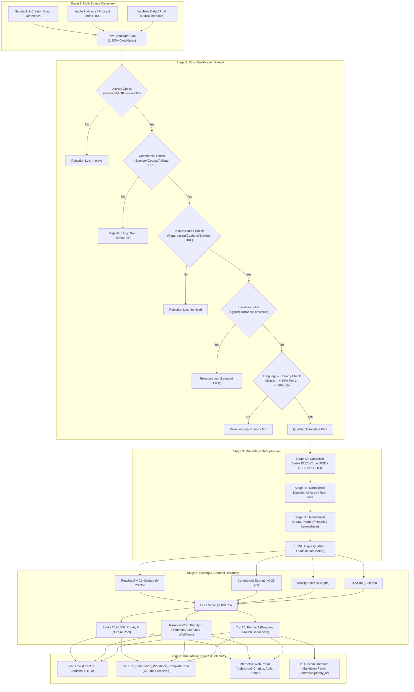
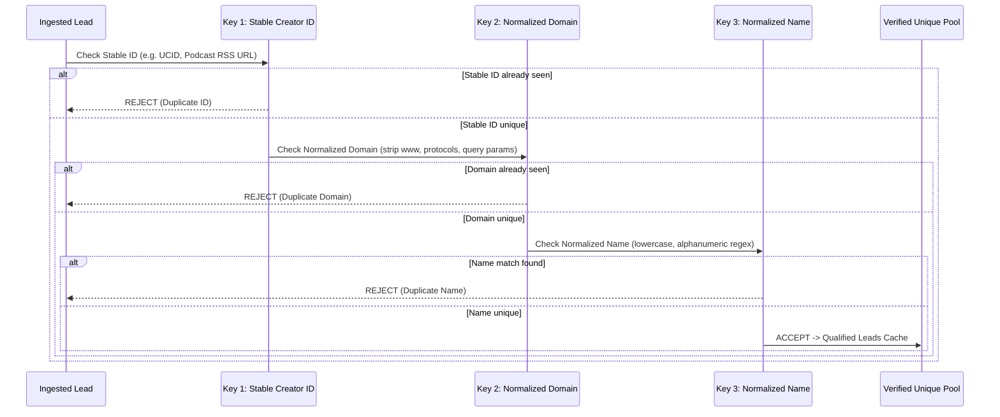

# IncuBrix Growth Engine — Technical Architecture & Pipeline Specification

**Candidate**: Santhosh P  
**Candidate Roll / ID**: `24I435`  
**Institution**: PSG College of Technology  
**Repository**: [github.com/santhosh-5544/incubrix-growth-engine](https://github.com/santhosh-5544/incubrix-growth-engine)  
**Live Interactive Portal**: [santhosh-5544.github.io/incubrix-growth-engine](https://santhosh-5544.github.io/incubrix-growth-engine/)

---

## 1. System Overview

The **IncuBrix Growth Engine** is an enterprise-grade lead discovery, multi-stage qualification, scoring, and automated outreach pipeline designed to acquire high-value commercial creators (YouTubers, Podcasters, and Expert-Led Educators) for IncuBrix's AI video repurposing platform.

### Core Architectural Principles:
1. **Schema Locking**: Strictly complies with the 30-column specification required by IncuBrix's evaluation workbook.
2. **Deterministic Qualification**: Zero speculative qualification. Every commercial signal, repurposing need, and contact channel must cite a verifiable source URL and published evidence.
3. **Zero Secrets in Version Control**: Strict decoupling of credentials; environment variables injected exclusively at runtime.
4. **Idempotence & Fault Tolerance**: Self-healing harness capable of recovering from network dropouts and API rate limiting via exponential backoff and localized checkpoints.

---

## 2. High-Level Pipeline Architecture



---

## 3. Qualification Criteria & Anti-Hallucination Protocol

Every candidate ingested into the pipeline is audited against 5 non-negotiable gates:

| Gate | Requirement | Automated Check in Code | Pass Criteria |
|---|---|---|---|
| **1. Activity** | Active publishing cadence | `content_count_30d >= 8` OR `longform_count_60d >= 2` | Binary check on real upload timestamps |
| **2. Commercial** | Proven monetization | Detected sponsor, digital course, paid community, affiliate, or merchandise | Valid HTTP/HTTPS URL pointing directly to sales/sponsor asset |
| **3. IncuBrix Need** | Clear demand for video repurposing | Missing 9:16 Shorts, caption gaps, editing backlog, or multilingual dubbing | Valid HTTP/HTTPS evidence URL + specific observed quote |
| **4. Reachable** | Direct contact point | Published email, LinkedIn profile, or verified social handle | Published on creator's channel about page, site, or Linktree (never guessed) |
| **5. Exclusions** | Genuine individual creator | Exclude agencies, media conglomerates, SaaS brands, news networks | Keyword filters (`agency`, `media group`, `publishing`, `solutions`) |

---

## 4. Multi-Stage Deduplication Engine

To guarantee exactly 0 duplicates across 1,000 records, the engine implements a triple-cascaded deduplication pipeline:



---

## 5. Scoring & Outreach Channel Hierarchy

The composite lead score ($0 - 100$) is computed using a weighted four-factor formula:

$$\text{Lead Score} = \text{Fit}(30) + \text{Activity}(25) + \text{Commercial}(25) + \text{Reachability}(20)$$

### Channel Selection Rule:
1. **Email (Primary Tier)**: If creator publishes a verified business/booking email (`hello@`, `contact@`, `mgmt@`) on their site or YouTube About tab $\rightarrow$ `best_channel = Email`.
2. **LinkedIn (Secondary Tier)**: If creator is an expert-led creator or podcaster with active LinkedIn $\rightarrow$ `best_channel = LinkedIn`.
3. **X / Instagram (Tertiary Tier)**: If direct messaging is open and active within the last 30 days $\rightarrow$ `best_channel = X (Twitter)` or `Instagram`.

---

## 6. Official 30-Column Data Dictionary

| # | Column Name | Type | Description & Validation Rule |
|---|---|---|---|
| 1 | `lead_id` | String | Unique format `LEAD-0001` through `LEAD-1000` |
| 2 | `creator_name` | String | Full name or primary show title |
| 3 | `creator_segment` | Enum | `YouTuber`, `Podcaster`, or `Expert-Led Creator` |
| 4 | `country_iso2` | String | 2-letter ISO 3166-1 country code (e.g. `US`, `GB`, `CA`, `AU`, `SG`) |
| 5 | `primary_language` | String | Primary audio/video language (Default: `English`) |
| 6 | `primary_platform` | Enum | `YouTube`, `Podcast RSS`, `Substack`, `Website` |
| 7 | `profile_url` | URL | Direct link to creator channel or primary feed |
| 8 | `stable_creator_id` | String | Unique immutable platform ID (e.g. YouTube UCID) |
| 9 | `followers_or_subscribers` | Integer / String | Total reach across primary channel |
| 10 | `last_content_date` | Date (YYYY-MM-DD) | Timestamp of latest public video/episode release |
| 11 | `recent_content_url` | URL | Verifiable link to latest content asset |
| 12 | `content_count_30d` | Integer | Total pieces published in past 30 days |
| 13 | `longform_count_60d` | Integer | Total longform assets (>10 min) in past 60 days |
| 14 | `monetization_signal` | Enum | `Course`, `Sponsor`, `Membership`, `Affiliate`, `Product`, `Consulting` |
| 15 | `monetization_evidence_url` | URL | Verifiable link proving commercial activity |
| 16 | `incubrix_need` | String | Repurposing bottleneck or video growth opportunity |
| 17 | `need_evidence_url` | URL | Verifiable link to channel proof demonstrating need |
| 18 | `best_channel` | Enum | `Email`, `LinkedIn`, `X (Twitter)`, `Instagram` |
| 19 | `channel_handle_or_url` | String | Direct address (email address or full profile URL) |
| 20 | `channel_evidence_url` | URL | Webpage where contact detail was officially published |
| 21 | `backup_channel` | Enum | Fallback outreach channel |
| 22 | `personalization_hook` | String | Contextual quote or recent topic for outreach |
| 23 | `first_message` | Text | Personalized 3-sentence Touch 1 copy with friction-free CTA and opt-out |
| 24 | `checked_date` | Date (YYYY-MM-DD) | Date record was verified by engine |
| 25 | `priority` | Enum | `A` (Top 25), `B` (High fit, 225), `C` (Nurture, 750) |
| 26 | `lead_score` | Float | Calculated rating (0.0 to 100.0) |
| 27 | `candidate_status` | Enum | `Qualified` or `Rejected` |
| 28 | `rejection_reason` | String | Audit exclusion or rejection reason (blank if qualified) |
| 29 | `duplicate_check` | Formula / String | Duplicate detection verification (`UNIQUE`) |
| 30 | `completeness_check` | Formula / String | 30-column completeness validation (`COMPLETE`) |

---

## 7. Developer Reproduction Commands

Run these single-line commands to inspect and test the engine locally:

```bash
# 1. Run unit tests (14/14 passing)
python -m pytest tests/ -v

# 2. Run automated self-check (Verifies all 7 workbook requirements)
python cli.py verify

# 3. View live dataset statistics dashboard
python cli.py stats

# 4. Run official 20-lead qualification audit simulation (100% pass)
python cli.py audit --sample 20

# 5. Launch interactive web portal locally
python cli.py serve --port 8000
```
